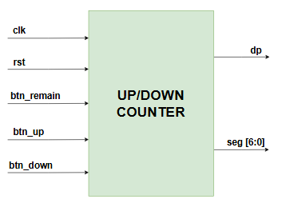
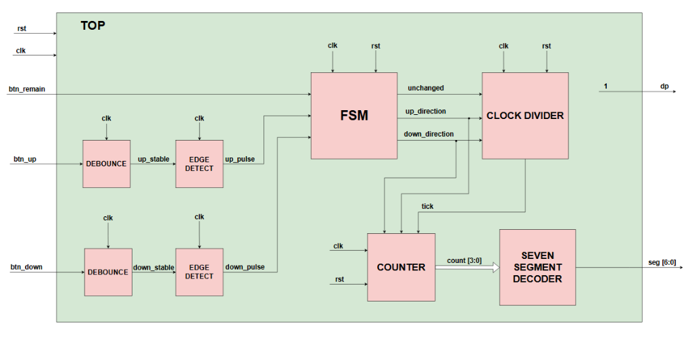
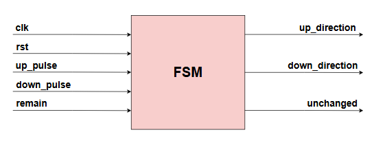
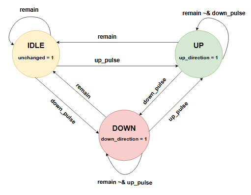
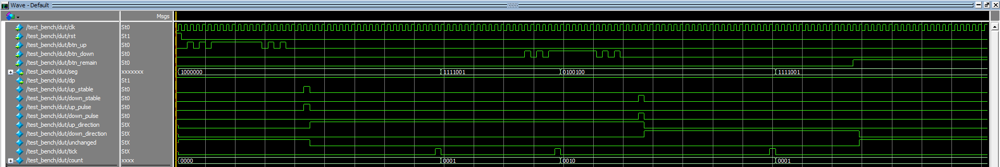
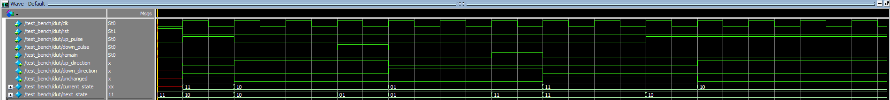
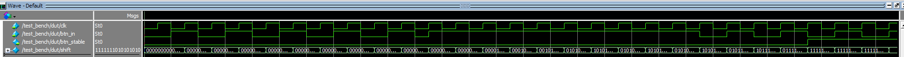
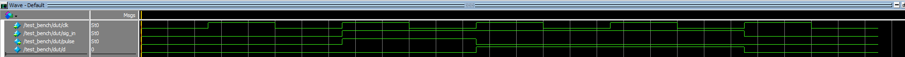
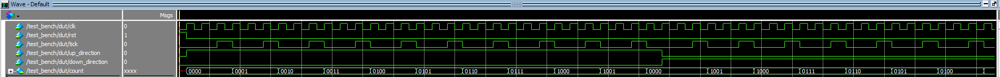

# ⚡ PolarFire SoC FPGA Multi-mode Digital System

[](https://www.microchip.com/en-us/products/fpgas-and-plds/fpga-and-soc-design-tools/fpga/polarfire-soc-polarfire)
[](https://www.microchip.com/en-us/products/fpgas-and-plds/fpga-and-soc-design-tools/libero-soc-design-suite)
[](https://www.microchip.com)
[]()
[](LICENSE)

> **Tác giả (Author)**: Lê Anh Khoa ([@KhoaLe246205](https://github.com/KhoaLe246205))  
> **Email liên hệ**: khoalekhoaanh2462005@gmail.com  
> **Phần cứng mục tiêu**: Microchip PolarFire SoC FPGA Discovery Kit (MPFS095T-1FCSG325E).  
> **Trọng tâm thiết kế**: Thiết kế hệ thống đếm số đa chế độ hoàn chỉnh trên FPGA, điều hòa xung nhịp ngoại vi vật lý (Chống rung phím Debounce, Bắt cạnh xung Edge Detect), chia tần số thạch anh 50 MHz thành nhịp 1 Hz, và FSM điều khiển hiển thị LED 7 đoạn.

---

## 📑 Mục Lục (Table of Contents)
1. [Tổng Quan Hệ Thống & Bài Toán Kỹ Thuật (System Overview)](#1-tổng-quan-hệ-thống--bài-toán-kỹ-thuật-system-overview)
2. [Kiến Trúc Phần Cứng & Sơ Đồ Khối (Hardware Architecture)](#2-kiến-trúc-phần-cứng--sơ-đồ-khối-hardware-architecture)
   - [2.1. Biểu tượng Khối Mức Đỉnh (Top-Level Block Symbol)](#21-biểu-tượng-khối-mức-đỉnh-top-level-block-symbol)
   - [2.2. Sơ đồ Kiến trúc Mức Đỉnh Toàn Hệ Thống (Top Datapath Architecture)](#22-sơ-đồ-kiến-trúc-mức-đỉnh-toàn-hệ-thống-top-datapath-architecture)
   - [2.3. Tư Duy Thiết Kế Phần Cứng & Tối Ưu Hóa (Key Engineering Decisions & Design Rationale)](#23-tư-duy-thiết-kế-phần-cứng--tối-ưu-hóa-key-engineering-decisions--design-rationale)
3. [Đặc Tả Máy Trạng Thái Hữu Hạn (FSM Controller Specification)](#3-đặc-tả-máy-trạng-thái-hữu-hạn-fsm-controller-specification)
   - [3.1. Biểu tượng & Giao diện Khối FSM](#31-biểu-tượng--giao-diện-khối-fsm)
   - [3.2. Sơ đồ Chuyển Trạng Thái (State Transition Diagram)](#32-sơ-đồ-chuyển-trạng-thái-state-transition-diagram)
4. [Phân Tích Chi Tiết Các Khối Chức Năng (Submodule Descriptions)](#4-phân-tích-chi-tiết-các-khối-chức-năng-submodule-descriptions)
   - [4.1. Khối Chống Rung Phím (Debounce)](#41-khối-chống-rung-phím-debounce)
   - [4.2. Khối Bắt Cạnh Tạo Xung (Edge Detect)](#42-khối-bắt-cạnh-tạo-xung-edge-detect)
   - [4.3. Khối Chia Tần Số Xung Nhịp (Clock Divider - 50 MHz sang 1 Hz)](#43-khối-chia-tần-số-xung-nhịp-clock-divider---50-mhz-sang-1-hz)
   - [4.4. Khối Bộ Đếm (Counter Unit) & Giải Mã LED 7 Đoạn (Seven Segment Decoder)](#44-khối-bộ-đếm-counter-unit--giải-mã-led-7-đoạn-seven-segment-decoder)
5. [Đặc Tả Chân Vật Lý (Physical Pinout & Constraint Mapping)](#5-đặc-tả-chân-vật-lý-physical-pinout--constraint-mapping)
6. [Kết Quả Kiểm Chứng Mô Phỏng (Verification & Simulation Results)](#6-kết-quả-kiểm-chứng-mô-phỏng-verification--simulation-results)
7. [Cấu Trúc Thư Mục Dự Án (Project Structure)](#7-cấu-trúc-thư-mục-dự-án-project-structure)

---

## 1. Tổng Quan Hệ Thống & Bài Toán Kỹ Thuật (System Overview)

Khi triển khai các hệ thống số tương tác người dùng lên board FPGA thực tế (**Physical FPGA Hardware**), có hai thách thức vật lý cốt lõi cần phải giải quyết:

1. **Hiện tượng Rung Phím Cơ Học (Mechanical Switch Bouncing)**:  
   Khi người dùng nhấn một nút bấm cơ khí, tiếp điểm lá đồng không đóng ngắt tức thì mà va đập dao động (bouncing) liên tục trong khoảng thời gian từ $5\text{ ms} - 20\text{ ms}$. Nếu đưa trực tiếp tín hiệu này vào hệ thống số chạy ở tần số hàng chục MHz, mỗi lần nhấn nút sẽ bị nhận diện nhầm thành hàng trăm xung kích hoạt, làm sai lệch hoàn toàn trạng thái mong muốn.

2. **Chênh Lệch Tần Số Xung Nhịp (Clock Domain Mismatch)**:  
   Board PolarFire SoC Discovery Kit trang bị bộ dao động thạch anh **50 MHz** (`DSC1001DL5-050.0000` nối tới chân `R18`). Tần số 50 triệu chu kỳ/giây là quá nhanh đối với khả năng quan sát của mắt người. Để mắt có thể quan sát rõ từng bước đếm số trên LED 7 đoạn, tần số xung nhịp cần được chia nhỏ chính xác về **1 Hz** (1 nhịp mỗi giây).

Hệ thống số này giải quyết triệt để các bài toán trên thông qua chuỗi xử lý tín hiệu hoàn chỉnh:
$$\text{Button Inputs} \xrightarrow{\text{Debounce}} \text{Stable Level} \xrightarrow{\text{Edge Detect}} \text{Single-Cycle Pulse} \xrightarrow{\text{FSM}} \text{Mode Control} \xrightarrow{\text{Clock Divider + Counter}} \text{7-Segment Display}$$

---

## 2. Kiến Trúc Phần Cứng & Sơ Đồ Khối (Hardware Architecture)

### 2.1. Biểu tượng Khối Mức Đỉnh (Top-Level Block Symbol)

Module mức đỉnh [`top.v`](file:///D:/Portfolio_GitHub/03_PolarFire_FPGA_Digital_System/rtl/top.v) đóng gói toàn bộ hệ thống đếm số đa chế độ:

<p align="center">
  
  <br>
  <em>Hình 1: Biểu tượng mức đỉnh UP/DOWN COUNTER và các cổng giao tiếp ngoại vi</em>
</p>

#### Bảng Đặc Tả Tín Hiệu Giao Tiếp (Interface Specifications):
| Tên Cổng (Port) | Độ Rộng | Hướng | Miêu Tả Chức Năng (Description) |
| :--- | :---: | :---: | :--- |
| `clk` | 1 bit | Input | Xung nhịp hệ thống 50 MHz từ bộ dao động thạch anh on-board (Chân `R18`). |
| `rst` | 1 bit | Input | Tín hiệu reset đồng bộ tích cực mức cao (Chân nút bấm `AA19`). |
| `btn_remain` | 1 bit | Input | Tín hiệu chuyển mạch giữ nguyên trạng thái đếm hiện tại (Chân công tắc `V21`). |
| `btn_up` | 1 bit | Input | Nút bấm điều khiển hệ thống chuyển sang chế độ đếm lên (Chân `U18`). |
| `btn_down` | 1 bit | Input | Nút bấm điều khiển hệ thống chuyển sang chế độ đếm xuống (Chân `T19`). |
| `dp` | 1 bit | Output | Điều khiển dấu chấm thập phân trên LED 7 đoạn (Chân `Y15`, gán cố định mức `1`). |
| `seg[6:0]` | 7 bit | Output | Bus điều khiển 7 thanh LED hiển thị số (`a, b, c, d, e, f, g`). |

---

### 2.2. Sơ đồ Kiến trúc Mức Đỉnh Toàn Hệ Thống (Top Datapath Architecture)

Sơ đồ khối vi kiến trúc tích hợp bên trong module `top`:

<p align="center">
  
  <br>
  <em>Hình 2: Sơ đồ kiến trúc vi mạch mức đỉnh tích hợp các khối xử lý tín hiệu và điều khiển</em>
</p>

#### Luồng dữ liệu và điều khiển (Datapath Flow):
1. **Tiền xử lý nút bấm**:
   - `btn_up` được lọc qua `DEBOUNCE db_up` tạo tín hiệu `up_stable`, sau đó qua `EDGE DETECT up` tạo xung rộng đúng 1 chu kỳ clock: `up_pulse`.
   - `btn_down` được lọc qua `DEBOUNCE db_down` tạo tín hiệu `down_stable`, sau đó qua `EDGE DETECT down` tạo xung: `down_pulse`.
   - `btn_remain` được nối trực tiếp vào chân `remain` của khối `FSM` (do đây là tín hiệu giữ trạng thái mức - Level-sensitive).
2. **Khối FSM trung tâm**:
   - Nhận các xung lệnh `up_pulse`, `down_pulse`, và trạng thái `remain` để quyết định hướng hoạt động của hệ thống, phát ra 3 cờ điều khiển: `up_direction`, `down_direction`, và `unchanged`.
3. **Bộ chia tần số Clock Divider**:
   - Chia xung nhịp 50 MHz thành xung `tick` (tần số 1 Hz). Khi `unchanged = 1` hoặc khi đổi chiều đếm (`dir_changed = 1`), bộ đếm chia tần được reset tức thì để đảm bảo tính thời gian chính xác.
4. **Bộ đếm Counter & Bộ giải mã LED 7 đoạn**:
   - `COUNTER` thực hiện tăng/giảm giá trị 4-bit `count[3:0]` mỗi khi có xung `tick = 1` từ Clock Divider.
   - `SEVEN SEGMENT DECODER` nhận `count[3:0]` và giải mã sang bus 7-bit `seg[6:0]` để lái màn hình hiển thị.

---

### 2.3. Tư Duy Thiết Kế Phần Cứng & Tối Ưu Hóa (Key Engineering Decisions & Design Rationale)

Để tối ưu hóa diện tích vi mạch (logic area), tần số hoạt động cực đại ($F_{\max}$) và đảm bảo tính tin cậy tuyệt đối khi triển khai trên phần cứng thực tế của PolarFire FPGA, hai quyết định kiến trúc quan trọng đã được áp dụng:

#### 1. Tại sao tín hiệu `btn_remain` được nối trực tiếp vào FSM mà KHÔNG qua Debounce và Edge Detect?
* **Bản chất điều khiển mức (Level-Sensitive) thay vì xung kích sườn (Edge-Triggered)**:
  * `btn_remain` được gán cho công tắc gạt (slide switch) hoặc nút bấm giữ mức trên bo mạch.
  * Trong module [`fsm.v`](file:///D:/Portfolio_GitHub/03_PolarFire_FPGA_Digital_System/rtl/fsm.v), tín hiệu `remain` đóng vai trò là một điều kiện **giữ/khóa trạng thái** liên tục (`if (remain) next_state = IDLE;`). Khi `remain = 1`, hệ thống bắt buộc phải duy trì ở trạng thái dừng `IDLE` qua hàng triệu chu kỳ xung nhịp cho đến khi người dùng gạt tắt.
  * *Nếu cho qua khối `edge_detect`*: Tín hiệu sẽ bị co lại thành một xung duy nhất có độ rộng đúng **1 chu kỳ clock ($20\text{ ns}$)** rồi rơi về `0`. Sau chu kỳ đó, FSM sẽ ngay lập tức thoát khỏi `IDLE` nếu có nhịp đếm tiếp theo, làm mất hoàn toàn chức năng "giữ nguyên trạng thái".
* **Miễn nhiễm rung phím theo logic & Phản hồi tức thì (Zero-Latency Override)**:
  * Hiện tượng rung phím cơ học chỉ xảy ra trong vài micro-giây lúc tiếp điểm đóng/ngắt. Ngay từ xung nảy đầu tiên, FSM đã lập tức nhận diện mức cao và chuyển về `IDLE`. Các dao động nảy tiếp theo ($1 \to 0 \to 1$) vẫn chỉ duy trì hoặc đưa FSM trở lại `IDLE`.
  * Bỏ qua khối debounce giúp tính năng dừng khẩn cấp phản hồi ngay lập tức với độ trễ bằng 0 (Zero-latency override), đồng thời tiết kiệm tài nguyên Flip-Flop trên FPGA.

#### 2. Tại sao hai khối `debounce` và `edge_detect` KHÔNG cần tín hiệu Reset (`rst`)?
* **Đặc tính tự khởi tạo & tự xả sạch đường ống (Self-Synchronizing / Self-Flushing Pipeline)**:
  * Khối `debounce` sử dụng thanh ghi dịch (Shift Register) dịch liên tục:
    ```verilog
    always @(posedge clk) begin
        shift <= {shift[WIDTH-2:0], btn_in};
    end
    ```
    Tại thời điểm cấp nguồn (Power-on), dù các flip-flop ban đầu chứa giá trị bất định nào, chỉ sau đúng `WIDTH` chu kỳ xung nhịp (ở 50 MHz với `WIDTH = 16` chỉ mất $320\text{ ns}$), toàn bộ giá trị cũ sẽ tự động bị đẩy ra ngoài và thanh ghi sẽ bám sát 100% trạng thái thực của nút bấm trước khi người dùng kịp tương tác.
  * Tương tự, khối `edge_detect` sử dụng 1 D-Flip-Flop trễ (`d <= sig_in;`). Chỉ sau đúng **1 chu kỳ xung clock ($20\text{ ns}$)**, ngõ ra `d` đã đồng bộ hoàn toàn với `sig_in`.
* **Ngăn ngừa xung kích ảo khi thoát Reset (False Trigger Glitch Prevention)**:
  * Nếu `edge_detect` có chân reset: Khi tín hiệu `rst` tích cực, `d` bị cưỡng bức về `0`. Giả sử lúc nhả reset mà nút bấm đang được nhấn giữ (`sig_in = 1`), thì ngay chu kỳ clock đầu tiên khi vừa thoát reset:
    $$\text{pulse} = \text{sig} \cdot \overline{d} = 1 \cdot \overline{0} = 1$$
    *(tương ứng biểu thức logic Verilog: `pulse = sig_in & ~d = 1 & ~0 = 1`)*
    Mạch sẽ tự động phát ra một **xung kích ảo (False Pulse)** khiến FSM nhảy sai trạng thái ngoài ý muốn ngay khi vừa khởi động! Việc loại bỏ `rst` đảm bảo `d` luôn bám sát `sig_in`, triệt tiêu hoàn toàn xung giả này.
* **Tối ưu hóa tài nguyên mạng định tuyến FPGA (FPGA Routing & Area Optimization)**:
  * Cây phân phối Reset toàn cục (Global Reset Network) trên FPGA PolarFire là tài nguyên quý giá. Việc không dùng reset cho các đường ống tự xả cho phép bộ tổng hợp (Libero SoC / Synplify Pro) dễ dàng suy luận thành các cấu trúc phần cứng tối ưu (Shift Register LUTs - SRL primitives), giảm tải fan-out của mạng reset và tăng tần số hoạt động cực đại $F_{\max}$.

---

## 3. Đặc Tả Máy Trạng Thái Hữu Hạn (FSM Controller Specification)

### 3.1. Biểu tượng & Giao diện Khối FSM

Khối [`fsm.v`](file:///D:/Portfolio_GitHub/03_PolarFire_FPGA_Digital_System/rtl/fsm.v) đóng vai trò bộ não điều phối toàn bộ hành vi đếm của hệ thống:

<p align="center">
  
  <br>
  <em>Hình 3: Biểu tượng khối điều khiển trạng thái FSM (Finite State Machine)</em>
</p>

* **Đầu vào (Inputs)**: `clk`, `rst`, `up_pulse`, `down_pulse`, `remain`.
* **Đầu ra (Outputs)**:
  * `up_direction`: Bật mức `1` khi hệ thống đang ở trạng thái đếm lên.
  * `down_direction`: Bật mức `1` khi hệ thống đang ở trạng thái đếm xuống.
  * `unchanged`: Bật mức `1` khi hệ thống ở trạng thái đứng yên/tạm dừng (IDLE).

---

### 3.2. Sơ đồ Chuyển Trạng Thái (State Transition Diagram)

FSM được thiết kế theo mô hình **Moore Machine** gồm 3 trạng thái logic rõ ràng:

<p align="center">
  
  <br>
  <em>Hình 4: Sơ đồ chuyển đổi trạng thái của bộ điều khiển FSM</em>
</p>

#### Bảng Mã Hóa Trạng Thái & Logic Chuyển Đổi:
| Trạng thái | Mã hóa | Tín hiệu ngõ ra | Điều kiện chuyển tiếp |
| :---: | :---: | :--- | :--- |
| **`IDLE`** | `2'b11` | `unchanged = 1`<br>`up_direction = 0`<br>`down_direction = 0` | • Nếu `remain = 1`: Giữ nguyên ở `IDLE`.<br>• Nếu `up_pulse = 1`: Chuyển sang `UP`.<br>• Nếu `down_pulse = 1`: Chuyển sang `DOWN`. |
| **`UP`** | `2'b10` | `up_direction = 1`<br>`unchanged = 0`<br>`down_direction = 0` | • Nếu `remain = 1`: Chuyển về `IDLE`.<br>• Nếu `down_pulse = 1`: Chuyển sang `DOWN`.<br>• Ngược lại (`remain ~& down_pulse`): Giữ nguyên ở `UP`. |
| **`DOWN`** | `2'b01` | `down_direction = 1`<br>`unchanged = 0`<br>`up_direction = 0` | • Nếu `remain = 1`: Chuyển về `IDLE`.<br>• Nếu `up_pulse = 1`: Chuyển sang `UP`.<br>• Ngược lại (`remain ~& up_pulse`): Giữ nguyên ở `DOWN`. |

---

## 4. Phân Tích Chi Tiết Các Khối Chức Năng (Submodule Descriptions)

### 4.1. Khối Chống Rung Phím (Debounce)
* **File nguồn**: [`rtl/debounce.v`](file:///D:/Portfolio_GitHub/03_PolarFire_FPGA_Digital_System/rtl/debounce.v)
* **Cơ chế hoạt động**: Sử dụng thanh ghi dịch `shift` 16-bit hoạt động liên tục theo xung `clk`:
  ```verilog
  reg [WIDTH-1:0] shift = 0;
  always @(posedge clk) begin
      shift <= {shift[WIDTH-2:0], btn_in};
  end
  assign btn_stable = &shift[WIDTH-1:WIDTH-8];
  ```
  Tín hiệu chỉ được công nhận là ổn định (`btn_stable = 1`) khi toàn bộ 8 mẫu liên tiếp gần nhất đều đọc được mức logic cao (`1`), lọc bỏ hoàn toàn xung nhiễu quá độ.

---

### 4.2. Khối Bắt Cạnh Tạo Xung (Edge Detect)
* **File nguồn**: [`rtl/edge_detect.v`](file:///D:/Portfolio_GitHub/03_PolarFire_FPGA_Digital_System/rtl/edge_detect.v)
* **Cơ chế hoạt động**:
  ```verilog
  reg d = 0;
  always @(posedge clk) begin
      d <= sig_in;
  end
  assign pulse = sig_in & ~d;
  ```
  Phát hiện sườn dương (Rising Edge) của tín hiệu ổn định và sinh ra một xung duy nhất có độ rộng chính xác bằng **1 chu kỳ xung clock** ($20\text{ ns}$ ở 50 MHz).

---

### 4.3. Khối Chia Tần Số Xung Nhịp (Clock Divider - 50 MHz sang 1 Hz)
* **File nguồn**: [`rtl/clock_divider.v`](file:///D:/Portfolio_GitHub/03_PolarFire_FPGA_Digital_System/rtl/clock_divider.v)
* **Tham số phần cứng thật (Hardware Parameter)**:
  * `parameter CLK_FREQ = 50_000_000` (Tần số thạch anh 50 MHz trên board PolarFire).
  * `parameter TICK_HZ = 1` (Tần số nhịp đếm 1 Hz = 1 giây/bước).
  * **Tỉ số chia xung nhịp (Clock Division Ratio)**:
    $$\text{DIV} = \frac{f_{\text{CLK}}}{f_{\text{TICK}}} = \frac{50\text{ MHz}}{1\text{ Hz}} = 50{,}000{,}000\text{ chu kỳ (cycles)}$$
    *(Tương ứng với các tham số phần cứng: `CLK_FREQ = 50_000_000` và `TICK_HZ = 1`)*
* **Tính năng tối ưu động**:
  * Khi người dùng đảo chiều đếm giữa UP và DOWN (`dir_changed = 1`) hoặc khi giữ nguyên (`unchanged = 1`), bộ đếm `cnt` được reset về `0` ngay lập tức, ngăn ngừa hiện tượng nhịp đầu tiên bị ngắn bất thường khi chuyển trạng thái.

---

### 4.4. Khối Bộ Đếm (Counter Unit) & Giải Mã LED 7 Đoạn (Seven Segment Decoder)
* **File nguồn**: [`rtl/counter.v`](file:///D:/Portfolio_GitHub/03_PolarFire_FPGA_Digital_System/rtl/counter.v), [`rtl/7seg_decoder.v`](file:///D:/Portfolio_GitHub/03_PolarFire_FPGA_Digital_System/rtl/7seg_decoder.v)
* **Cơ chế**:
  * Khối `counter` thực hiện đếm modulo-10 ($0 \rightarrow 9$) khi `up_en = 1` và đếm lùi ($9 \rightarrow 0$) khi `down_en = 1` tại mỗi sườn tích cực của xung `tick`.
  * Khối `7seg_decoder` là mạch tổ hợp ánh xạ mã nhị phân 4-bit `count[3:0]` sang điều khiển 7 đoạn LED hiển thị rõ ràng các chữ số từ 0 đến 9.

---

## 5. Đặc Tả Chân Vật Lý (Physical Pinout & Constraint Mapping)

Tệp ràng buộc chân vật lý **PDC (Physical Design Constraints)** được cấu hình chính xác cho chip **PolarFire SoC MPFS095T-1FCSG325E** trong [`libero/constraint/io/user.pdc`](file:///D:/Portfolio_GitHub/03_PolarFire_FPGA_Digital_System/libero/constraint/io/user.pdc):

| Tên Cổng RTL | Tên Chân FPGA | I/O Standard | Thiết Bị Ngoại Vi On-Board |
| :--- | :---: | :---: | :--- |
| `clk` | **R18** | LVCMOS33 | Bộ dao động thạch anh 50 MHz (`DSC1001DL5-050.0000`). |
| `rst` | **AA19** | LVCMOS33 | Nút bấm Reset hệ thống (Push Button). |
| `btn_remain`| **V21** | LVCMOS33 | Công tắc gạt giữ trạng thái (Slide Switch). |
| `btn_up` | **U18** | LVCMOS33 | Nút bấm đếm lên (Push Button UP). |
| `btn_down` | **T19** | LVCMOS33 | Nút bấm đếm xuống (Push Button DOWN). |
| `dp` | **Y15** | LVCMOS33 | Chân dấu chấm LED 7 đoạn (Decimal Point). |
| `seg[0]` (`a`)| **V14** | LVCMOS33 | Thanh LED đoạn `a`. |
| `seg[1]` (`b`)| **U14** | LVCMOS33 | Thanh LED đoạn `b`. |
| `seg[2]` (`c`)| **Y13** | LVCMOS33 | Thanh LED đoạn `c`. |
| `seg[3]` (`d`)| **W13** | LVCMOS33 | Thanh LED đoạn `d`. |
| `seg[4]` (`e`)| **AA15** | LVCMOS33 | Thanh LED đoạn `e`. |
| `seg[5]` (`f`)| **AA14** | LVCMOS33 | Thanh LED đoạn `f`. |
| `seg[6]` (`g`)| **Y14** | LVCMOS33 | Thanh LED đoạn `g`. |

---

## 6. Kết Quả Kiểm Chứng Mô Phỏng (Verification & Simulation Results)

Tất cả các module thành phần và toàn hệ thống đã được kiểm chứng hoạt động đồng bộ chính xác trên **ModelSim ME**:

### 6.1. Dạng sóng tích hợp toàn hệ thống (Top Integration Waveform)
<p align="center">
  
  <br>
  <em>Hình 5: Mô phỏng toàn hệ thống cho thấy sự phối hợp đồng bộ giữa xung nút bấm, FSM chuyển hướng và giá trị đếm hiển thị</em>
</p>

### 6.2. Dạng sóng chi tiết các module chức năng
| Khối Điều Khiển FSM (`fsm.v`) | Khối Khử Rung Phím (`debounce.v`) |
| :---: | :---: |
|  |  |
| *FSM chuyển đổi nhịp nhàng giữa UP, DOWN và IDLE* | *Lọc sạch hoàn toàn gai nhiễu rung phím cơ học* |

| Khối Bắt Cạnh (`edge_detect.v`) | Khối Chia Tần (`clock_divider.v`) & Bộ Đếm (`counter.v`) |
| :---: | :---: |
|  |  |
| *Tạo xung rộng đúng 1 chu kỳ clock duy nhất* | *Chia tần sinh nhịp tick và đếm tuần tự 0 - 9* |

---

## 7. Cấu Trúc Thư Mục Dự Án (Project Structure)

```text
03_PolarFire_FPGA_Digital_System/
├── rtl/                                     # Mã nguồn Verilog RTL có thể tổng hợp
│   ├── top.v                                # Module mức đỉnh kết nối toàn bộ hệ thống
│   ├── debounce.v                           # Khối khử rung phím tiếp điểm cơ học
│   ├── edge_detect.v                        # Khối tạo xung bắt cạnh rộng 1 chu kỳ clock
│   ├── fsm.v                                # Máy trạng thái hữu hạn điều khiển chiều đếm
│   ├── clock_divider.v                      # Khối chia tần số từ 50 MHz xuống 1 Hz
│   ├── counter.v                            # Bộ đếm 4-bit Up/Down modulo-10
│   └── 7seg_decoder.v                       # Bộ giải mã LED 7 đoạn
├── tb/                                      # Testbench mô phỏng kiểm tra chức năng
│   └── test_bench.v                         # Testbench tích hợp kiểm tra toàn hệ thống
├── images/                                  # Sơ đồ khối kiến trúc & FSM nhúng trong README
│   ├── fpga_top_symbol.png                  # Biểu tượng khối UP/DOWN COUNTER
│   ├── fpga_top_architecture.png            # Sơ đồ kiến trúc mức đỉnh toàn hệ thống
│   ├── fpga_fsm_symbol.png                  # Biểu tượng khối điều khiển FSM
│   └── fpga_fsm_state_diagram.png           # Sơ đồ chuyển đổi trạng thái FSM
├── waveforms/                               # Ảnh chụp kết quả mô phỏng ModelSim
│   ├── top_wave.png                         # Dạng sóng tích hợp toàn hệ thống
│   ├── fsm_wave.png                         # Dạng sóng kiểm chứng FSM
│   ├── debounce_wave.png                    # Dạng sóng kiểm chứng khử rung phím
│   ├── edge_detect_wave.png                 # Dạng sóng kiểm chứng tạo xung bắt cạnh
│   └── counter_wave.png                     # Dạng sóng kiểm chứng bộ đếm
├── libero/                                  # Toàn bộ project Microchip Libero SoC v2025.1
│   ├── Connter.prjx                         # Tệp dự án Libero SoC
│   ├── constraint/io/user.pdc               # Tệp ràng buộc chân vật lý (PDC)
│   ├── hdl/                                 # Mã nguồn HDL liên kết trong Libero
│   └── designer/top/                        # Báo cáo tổng hợp, vị trí đặt chân và routing
├── docs/                                    # Tài liệu phần cứng chính thức
│   └── PolarFire_SoC_FPGA_Discovery_Kit_User_Guide.pdf # Hướng dẫn sử dụng board mạch
├── .gitignore                               # Bỏ qua các file rác phát sinh khi build Libero
└── README.md                                # Tài liệu kỹ thuật chi tiết của dự án
```
